# OpenCode Go Limits для OpenCode Desktop

Плагин для нижней полосы OpenCode 2 Desktop: показывает остаток лимитов OpenCode Go —
5-часовой, недельный и месячный метры в виде маленьких круговых диаграмм с процентами и
временем до сброса.

<p align="center">
  
</p>

English version: [README.md](README.md).

## Требования

- OpenCode Desktop 2.3.x. GUI-API плагинов экспериментальный и может меняться между релизами.
- Подписка OpenCode Go с ключом, подключённым к OpenCode (`/connect` → OpenCode Go).
- Node.js 20+ — только если собираешь плагин сам; в архивах релизов уже есть собранный
  `dist/gui-experimental.cjs`.

## Установка из git (рекомендуется)

```bash
git clone https://github.com/edwardgra4ev/opencode-go-limits-gui-plugin \
  ~/.config/opencode/plugins/go-limits
```

Добавь плагин в `~/.config/opencode/opencode.json`:

```jsonc
{
  "plugins": ["./plugins/go-limits"],
}
```

Один раз перезапусти OpenCode Desktop. Полоса появится в правом нижнем углу окна.

## Установка из архива релиза

1. Скачай `opencode-go-limits-gui-plugin-vX.Y.Z.zip` из
   [Releases](https://github.com/edwardgra4ev/opencode-go-limits-gui-plugin/releases).
2. Распакуй в `~/.config/opencode/plugins/go-limits`.
3. Добавь `"./plugins/go-limits"` в `plugins` в `~/.config/opencode/opencode.json`.
4. Перезапусти Desktop.

## Установка из любого каталога

Плагин грузится из любого пути — укажи его в `plugins` абсолютно или относительно каталога
конфигурации:

```jsonc
{
  "plugins": ["/mnt/hdd/Dev/opencode-go-limt"],
}
```

## Что показывается

| Метр | Окно |
| --- | --- |
| 5 ч | 20% месячного лимита, стартует с первого использования, длится пять часов |
| Неделя | 50% месячного лимита, сброс в понедельник 00:00 UTC |
| Месяц | месячный лимит, сбрасывается с началом оплаченного периода |

Цвета кольца:

| Расход | Цвет |
| --- | --- |
| `< 80%` | приглушённый цвет темы |
| `80–99%` | жёлтый (`--v2-yellow-600`) |
| `≥ 100%` или статус API не `ok` | красный (`--v2-red-600`) |

В палитре команд есть **Обновить лимиты OpenCode Go**; в остальное время плагин обновляется
раз в 60 секунд, ответы сервера кэшируются на 60 секунд.

## Нет ключа — нет виджета

Серверная часть читает ключ `opencode-go` из `auth.json`, который использует сам OpenCode
(`$XDG_DATA_HOME/opencode/auth.json`, `~/.local/share/opencode/auth.json`,
`~/Library/Application Support/opencode/auth.json` или `%APPDATA%\opencode\auth.json`).

Без ключа плагин не регистрирует RPC, а окно не рисует ни полосу, ни команду обновления. Если
ключ добавили позже — перезагрузи плагины (или перезапусти Desktop): проверка выполняется при
загрузке плагина.

Запросы идут только на `https://opencode.ai/inference/go/v1/usage`; на другие хосты ключ не
отправляется.

## Сборка

```bash
npm install
npm run typecheck
npm run build      # пишет dist/gui-experimental.cjs
npm run watch      # пересборка и hot-reload GUI при правках
```

`dist/` коммитится: от него зависят архив релиза и проверка «dist is up to date» в CI.

## Релизы

CI (`.github/workflows/ci.yml`) запускает typecheck, сборку и проверяет, что `dist/`
соответствует исходникам. Release (`.github/workflows/release.yml`) срабатывает на тег `v*`,
сверяет тег с версией в `package.json`, собирает zip и публикует его с автоматическими
release notes:

```bash
npm version patch --no-git-tag-version
git commit -am "Release v0.1.1"
git tag v0.1.1
git push origin main --tags
```
